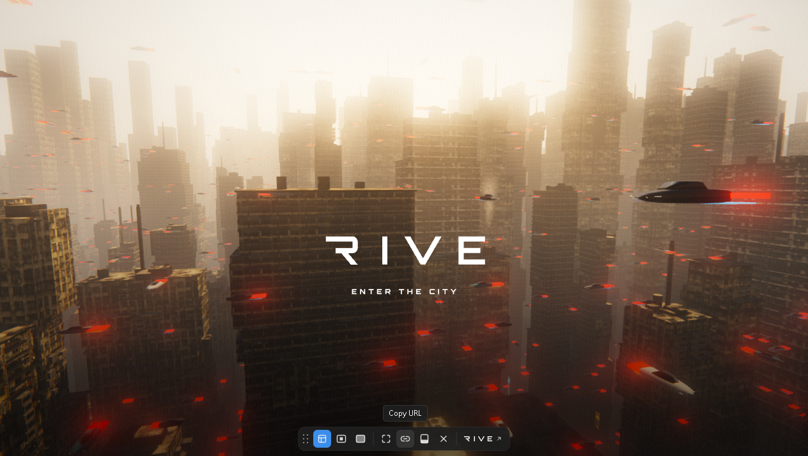

# RIVE CITY — offline mirror

Full mirror of **RIVE CITY** — a cinematic Rive WebGL2 city scene served by the
rive.to hosted player.

Source: https://rive-city-j6lc8r.uat.rive.to/



## Stack

- **Rive WebGL2 runtime** — `https://cdn.jsdelivr.net/npm/@rive-app/webgl2@2.x.x/rive.js`
  is loaded by the entry document and **stays a CDN dependency** (standing vendor
  rule: a CDN dependency is not backfilled into the capture; today the URL resolves
  to a 559,005 B bundle). Without internet the page cannot boot its runtime — the
  29.6 MB scene itself is captured locally.
- **rive.to hosted-player glue** — `_player/hosted.js`, one minified IIFE: finds
  `canvas[data-src]`, loads the `.riv` through `rive.RiveFile`, drives fit modes
  (`layout` / `contain` / `cover`), keyboard input (moveX/run/jump counters),
  the resolution watcher, and the page-controls drawer.
- **Two binary Rive artboards** — `file.riv` (the city scene + watermark) and
  `_player/drawer.riv` (the drawer controls UI: fit buttons, fullscreen, copy,
  hide, remove, build).
- **No framework, no build step** — static HTML, one IIFE, one stylesheet.

## What this is

RIVE CITY (rive-city-j6lc8r.uat.rive.to) is a **Rive demo deployment on the rive.to
hosted player** (UAT): a continuously animating, cinematic flythrough of a fog-lit
city — skyscraper canyons, flying cars with red light streaks, rooftop details — with
the RIVE / "ENTER THE CITY" wordmark baked into the artboard, and a dockable
page-controls drawer rendered from a second `.riv`. It is an **interactive artboard,
not a game**: the scene autoplays and loops; interaction is the player chrome (fit
mode, fullscreen, copy link, hide/remove/dock the drawer) plus pointer/keyboard input
wired into the artboard's view model. Captured whole — entry, player JS/CSS, favicon
and both Rive payloads: **6 files, 29,657,691 bytes (~28.3 MiB)**, dominated by
`file.riv` (29,616,149 B).

**UAT / ephemeral note:** the origin is a Rive **UAT** deployment (`rive-city`, id
`j6lc8r`) — UAT deploys are ephemeral by nature and may vanish or change without
notice. This mirror is the point-in-time capture (2026-10-12); the drift probe
documents what changed while the deploy lived.

External at runtime: the jsdelivr `rive.js` script (stays CDN, above),
a `preconnect` hint to `unpkg.com` (nothing is ever fetched from it), the
`POST /_v?…` analytics beacon (host-side, 204, not content), and the drawer's
build button which opens `https://rive.app/` in a new tab. No same-origin
reference is left uncaptured.

## Layout

- `index.html` — the served entry document (origin root; served path == disk path)
- `_player/` — `hosted.js` (player glue IIFE), `hosted.css`, `drawer.riv` (controls
  artboard), `favicon.ico`
- `file.riv` — the city scene payload (root-served, fetched by the player)
- `.upstream/manifest.json` — sha256 for every captured file
- `readable/` — prettified derived layer (pinned prettier 3.9.6): the player IIFE
  and the stylesheet
- `src/` + `split-spec.json` — statement-aligned slices of the player IIFE with
  the recorded derivation spec
- `tools/derive.mjs` — rebuild `readable/` + `src/` + `split-spec.json`
- `tools/update.mjs` — read-only drift probe against the live origin
- `tools/verify.mjs` — re-hash the capture against the manifest
- `tools/audit.js` — integrity gate for the derived layers (`AUDIT PASS`)
- `_mirror-report.json` — capture record (requests, fetches, external gaps)

## Assets

- **scenes (binary Rive artboards)** — 2 file(s): `file.riv` (the city scene,
  29,616,149 B), `_player/drawer.riv` (page-controls UI artboard, 9,513 B)
- **styles** — 1 file: `_player/hosted.css`
- **icons** — 1 file: `_player/favicon.ico`
- **audio** — none — the scene is silent (no audio files, no audio fetch)
- **fonts** — none as files: the RIVE wordmark/letters are vector art baked into
  the artboards (no font file is shipped or fetched)
- **data/document** — `index.html` (the entry document)

## Run

Serve the repo root through any static file server (the capture is a static site;
no build step). The entry is served at `/` and `_player/` + `file.riv` must sit
next to it, exactly as captured:

```
npx serve .
```

Then open `http://localhost:3000/` (needs internet for the CDN `rive.js`; the
scene payload loads from the local capture). Booting takes ~30-45 s — `file.riv`
is 29.6 MB and decodes into ~50 MB of WebGL textures.

## Verify

```
node tools/verify.mjs     # re-hash the capture against the manifest
node tools/audit.js       # derived-layer integrity gate (AUDIT PASS)
```

## Updating from upstream

```
node tools/update.mjs     # read-only drift probe: what changed upstream
```

The probe never rewrites the capture — a mirror is a point-in-time snapshot.
**The origin is a UAT deploy on rive.to: it may be gone at any time.** When it is,
the probe reports `live-missing` / `HTTP 404` for every file — that is expected and
still documents what the deploy served while it lived. Refreshing (while the deploy
is up) means re-fetching the full closure into a fresh tree and re-cutting the
readable/src layers on top of the new bytes.

### 2026-10-12 derivation + boot record

Both derived layers are in place, cut from the recorded capture (capture bytes
untouched — `node tools/verify.mjs` re-hashes all 6 files, `0 problems`):

- `readable/` — pinned prettier 3.9.6 (module API, default options, single pass
  verified idempotent — never the CLI, it respects `.gitignore` and can silently
  echo its input) rendered the player IIFE to `_player__hosted.pretty.js`
  (495 lines) and the stylesheet to `_player__hosted.pretty.css` (269 lines);
  names are capture-root-relative with dirs flattened with `__`. Both pretties are
  provably not byte copies of their sources and re-render byte-exact.
- `src/` — **5 statement-aligned slices** (`src/_player__hosted-01.js` …
  `-05.js`, exact 2-line provenance header) of the IIFE **body**, recorded in
  `split-spec.json` (8 sections): the whole app is one `(function(){…})()`
  expression, so the wrapper opener + `"use strict"` (lines 1-2) and the `})();`
  closer (line 495) are **skipped sections** (non-standalone), and everything
  between is sliced at top-level declaration boundaries — 5/5 parse standalone
  (`node --input-type=module --check -`) and round-trip byte-exact to their
  readable line ranges. Window size is ~100-140 lines (a recorded divergence
  from the fleet's 250-350 window: the whole app is 496 readable lines and the
  larger window would yield only two slices). This is a player-host glue file —
  there is no game/app JS to reverse beyond it, so `src/` is legitimately small.
- Binary/non-code payloads are **hashed `notRendered` records**, never sliced:
  `file.riv`, `_player/drawer.riv`, `_player/favicon.ico` (bytes + sha256, matched
  by the audit against the capture). The stylesheet is a wholeFile section
  (stylesheet rule). The CDN `rive.js` stays CDN and is not in the capture.
- The entry document references external scripts only (CDN `rive.js` +
  `/_player/hosted.js`) — zero inline `<script>`/`<style>` content blocks, so
  there are no `*-inline-N` twins and no `index-inline-map.json`.
- Closure: the `.riv` payloads were found from the entry document
  (`canvas data-src="/file.riv"`, `preload`) and from a string scan of
  `hosted.js` (`"/_player/drawer.riv"`), and the runtime fetches were confirmed
  with an opencli browser network log while the player booted (GET `/file.riv`
  200, GET `/_player/drawer.riv` 200, POST `/_v?…` 204; the `blob:` URLs in the
  log are in-memory decoded images, not files).
- Gates: `node tools/verify.mjs` → `6 files checked, 0 problems`;
  `node tools/audit.js` → `AUDIT PASS` (5/5 round-trips, 2/2 pretties re-render
  byte-exact, 3/3 binary records match the capture, 2/2 skipped wrapper sections
  re-verified). Serve probe — mirror root served on loopback, `/`, `/_player/hosted.js`,
  `/_player/hosted.css`, `/_player/favicon.ico`, `/_player/drawer.riv` and `file.riv`
  all over HTTP 200 with exact capture byte counts; listener PID killed, port 8731
  proven closed (netstat + connection refused).
- Boot test: the mirror was booted in the opencli browser on loopback — the WebGL2
  canvas draws the same scene as the live origin (city flythrough, flying cars, the
  RIVE wordmark), the drawer mounts after the watermark animation, and interaction
  was exercised (pointer hover/click on the drawer controls → "Copy URL" tip state;
  the drawer is draggable/dockable per the host script). Evidence:
  `docs/boot-2026-10-12.png` (active scene) and `docs/cover.png` (scene in play with
  the controls drawer visible). It is an interactive non-game artboard — the cover
  shows the scene in its most active state, honestly, not a menu or loading shot.
- §0.4 fork-over-mirror checked 2026-10-12: the page, the player JS and both `.riv`
  payloads carry **no public source-repo reference** (scanned for github.com /
  gitlab / sourceMappingURL — none); the only outbound product link is
  `https://rive.app/` (the drawer's build button), and `rive.to` redirects to the
  rive.app marketing site with no repo reference either. No forkable upstream repo
  exists, so the mirror stands.
- Open task: identifiers in `src/` are the bundle's own minified names — the
  PLAN §5 rename campaign was not run (the file is a single minified IIFE; a
  rename pass is possible but not yet done).

## Mirror conventions

- **Capture layer** — the captured files are byte-exact copies of what the origin
  served; nothing in them is edited.
- **Readable layer** — `readable/` is derived (prettified) and never shipped to a
  browser; it exists so the bundle can actually be read.
- **Provenance** — `.upstream/manifest.json` records sha256 for each captured
  artifact, and `tools/verify.mjs` re-checks it.
- **Drift** — `tools/update.mjs` is read-only: it reports what changed upstream
  and never rewrites the capture.
- **Vendor/CDN** — the rive.js CDN dependency stays CDN; it is documented, not
  backfilled. Vendor bytes are never re-minified or re-hosted.

## Fleet status

<!-- mirror-status:start — feeds _standard/REPO-INDEX.md. Update ONLY your own mirror's block; never edit the shared index (PLAN §8). Rebuild: node _standard/build-index.mjs -->
<!-- cols: cls=classification · ver=verify 0 problems · upd=drift probe · man=manifest · rdbl=readable re-derived · src=reversed src · boot=boot test · top=offline-mirror topic · tag=backup tag · staged=staged not committed -->
| # | repo | cls | ver | upd | man | rdbl | src | boot | top | tag | staged |
|---|---|---|---|---|---|---|---|---|---|---|---|
| 290 | rive-city | mirror | ✓ | ✓ | ✓ | ✓ | ✓ | ✓ | ✓ | — | — |
<!-- mirror-status:end -->
